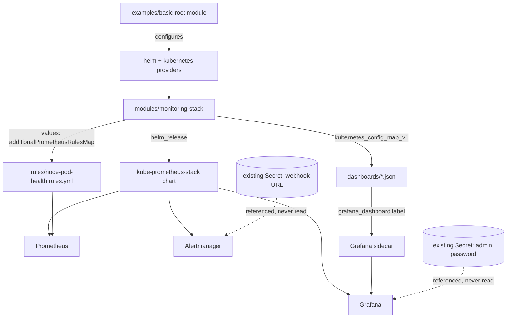

# terraform-prometheus-grafana-stack

A Terraform module that installs Prometheus, Grafana, and Alertmanager on a Kubernetes cluster
via the community `kube-prometheus-stack` Helm chart, with pre-configured node/pod health alert
rules and two starter dashboards.

**Scope.** The module is cloud-agnostic: it creates no cloud resources and configures no
provider itself. The caller supplies already-configured `helm` and `kubernetes` providers,
pointing at an EKS, AKS, GKE, or any other cluster - see the provider table below. Nothing here
has been applied against a real cluster; correctness is checked with `terraform validate` and
the native Terraform test framework against mock providers, plus `promtool` on the static rules
file and `jq` on the dashboard JSON.

## Architecture



## What this module creates

- One `helm_release` for the `kube-prometheus-stack` chart, pinned to version `92.21.2`
  (confirmed current against the chart's own `index.yaml` and ArtifactHub at the time this was
  built; `appVersion` for that chart release is `v0.94.2`).
- Node and pod health alert rules, loaded through the chart's `additionalPrometheusRulesMap`
  values key from `modules/monitoring-stack/rules/node-pod-health.rules.yml` - not a
  `kubernetes_manifest` `PrometheusRule`, because that resource type needs a live API server to
  plan against, and this module must plan cleanly with mock providers and no cluster.
- Two dashboards (`dashboards/node-health.json`, `dashboards/pod-health.json`), each as its own
  `kubernetes_config_map_v1`, labeled `grafana_dashboard = "1"` so the chart's built-in Grafana
  sidecar picks them up automatically - no separate Grafana API call needed.

## Prerequisites

- Terraform >= 1.9 (tested with 1.15.8). CI installs it via `hashicorp/setup-terraform`, pinned
  to `1.15.8` - no claim is made here about how that action verifies its own download.
- An already-configured `helm` provider (`~> 3.3`) and `kubernetes` provider (`~> 3.5`) pointed
  at the target cluster - this module does not configure either.
- Two Kubernetes Secrets that must already exist in the target namespace before applying:

  | Purpose | Example creation command |
  |---|---|
  | Alertmanager webhook URL | `kubectl create secret generic alertmanager-webhook --from-literal=url=https://hooks.example.com/REPLACE_ME -n monitoring` |
  | Grafana admin password | `kubectl create secret generic grafana-admin --from-literal=password=REPLACE_ME -n monitoring` |

  Neither secret's value is ever read by Terraform - only the secret and key *names* are passed
  in as variables.

## Provider configuration by cloud

The module takes whatever `helm`/`kubernetes` provider the caller gives it - these are the three
usual ways to point one at a managed cluster. `examples/basic` uses the plain kubeconfig form so
it runs the same way regardless of cloud.

| Cloud | Kubernetes provider | Notes |
|---|---|---|
| EKS | `exec { api_version = "client.authentication.k8s.io/v1beta1", command = "aws", args = ["eks", "get-token", "--cluster-name", var.cluster_name] }` | Needs the AWS CLI on the machine running Terraform |
| AKS | `host = data.azurerm_kubernetes_cluster.this.kube_config.0.host` plus the cluster's client cert/key/CA from the same data source | Typically paired with the `azurerm` provider to fetch `kube_config` |
| GKE | `host = "https://${data.google_container_cluster.this.endpoint}"` with a short-lived token from `data.google_client_config.default.access_token` | Token expires; re-run `terraform plan` to refresh it if it's stale |

## Usage

```hcl
module "monitoring_stack" {
  source = "./modules/monitoring-stack"

  namespace     = "monitoring"
  chart_version = "92.21.2"
  retention     = "15d"
  storage_size  = "20Gi"

  enable_alertmanager = true
  enable_grafana      = true

  alertmanager_webhook_secret_ref = {
    name = "alertmanager-webhook"
    key  = "url"
  }

  grafana_admin_password_secret_ref = {
    name = "grafana-admin"
    key  = "password"
  }

  providers = {
    helm       = helm
    kubernetes = kubernetes
  }
}
```

See `examples/basic` for a complete, runnable root module using this.

## Variables

| Name | Description | Default |
|---|---|---|
| `namespace` | Namespace the stack installs into | `"monitoring"` |
| `chart_version` | `kube-prometheus-stack` chart version | `"92.21.2"` |
| `retention` | Prometheus metric retention | `"15d"` |
| `storage_size` | Prometheus PVC size | `"20Gi"` |
| `enable_alertmanager` | Install Alertmanager | `true` |
| `enable_grafana` | Install Grafana | `true` |
| `alertmanager_webhook_secret_ref` | `{ name, key }` of an existing Secret holding the webhook URL | none - required |
| `grafana_admin_password_secret_ref` | `{ name, key }` of an existing Secret holding the admin password | none - required |

Every variable above has a `validation` block (format of `namespace`, `chart_version`, `retention`,
`storage_size`; non-empty `name`/`key` on both secret references) - see `tests/monitoring_stack.tftest.hcl`
for the exact cases checked.

## Security considerations

- The Alertmanager webhook URL and the Grafana admin password are never Terraform values - only
  the name and key of an existing Secret are. The webhook URL reaches Alertmanager by mounting
  that Secret into the pod and pointing `url_file` at the mounted path; the password reaches
  Grafana through the chart's own `admin.existingSecret`/`passwordKey` values.
- No example or default anywhere uses a real account ID, hostname, or credential -
  `123456789012` and `example.com`-style placeholders only.
- The module itself creates no IAM/cloud-level permissions; whatever the caller's `helm`/`kubernetes`
  provider can already reach is what this installs into.

## Idempotency

- `helm_release` and `kubernetes_config_map_v1` are both standard declarative Terraform
  resources - re-applying with unchanged inputs is a no-op.
- The dashboard ConfigMaps are keyed by filename (`dashboard-<name>`), so adding or removing a
  file under `dashboards/` changes exactly that one resource, never the others.

## Tests

```bash
terraform fmt -check -recursive
terraform -chdir=modules/monitoring-stack init -backend=false
terraform -chdir=modules/monitoring-stack validate
terraform -chdir=examples/basic init -backend=false
terraform -chdir=examples/basic validate
terraform init -backend=false
terraform test
promtool check rules modules/monitoring-stack/rules/node-pod-health.rules.yml
promtool test rules tests/rules.test.yml
jq empty modules/monitoring-stack/dashboards/node-health.json
jq empty modules/monitoring-stack/dashboards/pod-health.json
```

`terraform test` (native framework, `tests/monitoring_stack.tftest.hcl`) runs against
`mock_provider` stand-ins for both `helm` and `kubernetes` - no cluster, no real Helm or
Kubernetes API calls. It covers: both rule groups and both dashboard ConfigMaps render with
default inputs; the admin password comes from the secret reference, not a plaintext value; the
two feature flags propagate into the chart values; `retention`/`storage_size` propagate; and six
negative cases, one per validation block (bad namespace, bad chart version, bad retention format,
bad storage size format, an empty secret key, and an empty secret name) - each asserting the plan
fails with `expect_failures`.

`promtool test rules` (`tests/rules.test.yml`) covers all six alerts, one case where it fires and
one where it does not, each: `NodeNotReady`, `NodeMemoryPressure`, `NodeDiskPressure`,
`PodCrashLooping`, `PodNotReady`, `PodStuckPending` - checking the exact labels and rendered
annotation text promtool's simulated evaluation produces, not just that the rule file parses.

Dashboards are validated as JSON only (`jq empty`) - that confirms the files parse as valid JSON,
nothing about whether Grafana would accept them as a valid dashboard schema or render their
panels correctly.

## Status

Never applied against a real cluster. Validated only with `terraform fmt`, `terraform validate`,
`terraform test` against mock providers, `promtool check rules`, `promtool test rules`, and
`jq empty` on the dashboard JSON. Dashboards are checked only for being well-formed JSON - `jq`
does not know Grafana's dashboard schema, so a file that parses fine could still be rejected by
Grafana or render incorrectly; that path has never been checked against a real Grafana instance.
The Helm chart's own rendering, the Grafana sidecar's dashboard discovery, and the Alertmanager
`url_file` webhook path have not been exercised against a live chart install or a real cluster
either. Terraform itself is installed in CI through `hashicorp/setup-terraform`, pinned to
version `1.15.8` - how that action verifies its own download is not something this repo claims
to know.

## Known limits

- No Azure/AWS/GCP provider wiring is included - only the table above showing the shape of each.
- Dashboards are two fixed starter panels each (node/pod health); they are not meant to replace
  a full observability dashboard set.
- `additionalPrometheusRulesMap` is validated with `promtool` as a standalone rule file, not
  rendered through the actual Helm chart template - the chart's own CI already covers that
  rendering path, so this module only needs to prove the rule syntax itself is valid.
